<div align="center">

# Data Courier

Reliable one-way file transfer through a data diode.


</div>

## Features

- **Reliable**: error correction rebuilds lost packets on arrival, so nothing needs a resend.
- **Fast**: paced to the speed you set, encoding the next part while the current one is sent.
- **Highly configurable**: every part of the transfer is a commented setting.
- **No leftovers**: bounded memory, no leaks, and it cleans up after itself.
- **Light**: runs anywhere Docker does.
- **Easy to connect**: optionally announces every received file on RabbitMQ.

## How it works



## Running it

One image runs either side, chosen by `ENV_FOR_DYNACONF`:

```sh
docker compose -f receive.yml up -d   # on the receiving machine
docker compose -f send.yml up -d      # on the sending machine
```

Create one subfolder under `external/input` for each stream of files before starting the sender;
files dropped into `external/input/<folder>` arrive in `external/output/<folder>`.

Without Docker (Python 3.11):

```sh
pip install -r requirements.txt
ENV_FOR_DYNACONF=receive python -m src.common.main
ENV_FOR_DYNACONF=send python -m src.common.main
```

If any part fails, the whole app stops on purpose, so run it under a restart policy and it comes
back clean.

## Configuration

Settings live in `resources/` and are commented in place; any of them can be overridden with a
`COURIER_` environment variable.

**Set these first**, with the same values on both sides:

| Setting | What it is |
|---|---|
| `ip`, `port` | The receiver's address |
| `payload_size` | File bytes per packet; under 1.5 KB avoids IP fragmentation |
| `rabbitmq.*` | Where to announce received files, if you want that |

**The ones that matter most** for speed and memory:

| Setting | Side | Why change it |
|---|---|---|
| `pacer.speed_limit` | send | The total send speed. Set it to what the link and the receiver can sustain, counting every sender on the network |
| `encoder.packets_multiplier` | send | Redundancy. Raise it if files arrive incomplete; lower it for speed if they never do |
| `encoder.buffer_limit`, `sender.buffer_limit` | send | Memory for encoding and for packets waiting to go out. As high as RAM allows: survives loss bursts better and keeps the link busy |
| `socket.buffer_size` | receive | Kernel memory for incoming packets. As high as RAM allows, to absorb spikes; also raise the OS limit (`net.core.rmem_max` on Linux) |
| `shm.size` | receive | Memory for packets waiting to be processed, to absorb bursts. The container's `/dev/shm` must be at least this big |

## Getting the most out of it

When you first deploy, set `log_level = 'DEBUG'` and watch the logs for a while:

- **`Received incomplete file`**: packets were lost beyond what the redundancy covers. Raise
  `encoder.packets_multiplier` or lower `pacer.speed_limit`.
- **No incomplete files at all**: try lowering `encoder.packets_multiplier` for more speed.
- **`Processor is too slow`**: the receiver can't keep up. Lower `pacer.speed_limit` or raise
  `shm.size`.
- **A file arrives cut short because it was sent mid-write**: raise `scanner.file_ready_delay`.
