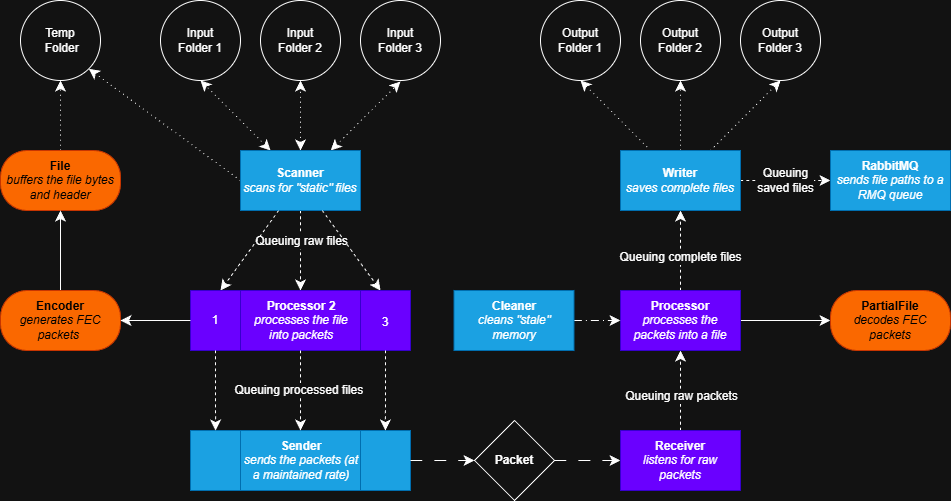

<div align="center">

# Data Courier

Reliable one-way file transfer through a data diode.


</div>

A data diode lets traffic flow in one direction only, so the receiving side can never acknowledge
a packet or ask for a resend. Data Courier makes that link reliable on its own: drop files into a
folder on one side, and they appear, whole, in the matching folder on the other.



## What went into it

- **Forward error correction**: every chunk is Reed-Solomon encoded (zfec), so any `k` of its `m` packets rebuild it.
- **Per-file coding**: `k` and `m` are chosen for each file's size, and travel inside every packet.
- **Loss-burst spreading**: packets are interleaved across many chunks, so a burst of loss costs each chunk only a little.
- **Tiny-file padding**: files smaller than one chunk are padded so they survive loss like large ones.
- **Multiple passes**: redundancy goes out in passes, so the first full copy arrives as early as possible.
- **Steady pacing**: a time-credit pacer holds the link at a set speed without bursts.
- **Fair sharing**: each input folder sends in its own process, and active senders split the speed limit evenly.
- **Safe pickup**: a file is taken only after it stops changing and is unlocked, then moved aside, so a restart resumes it.
- **Zero-copy receiving**: packets land straight in a shared-memory ring buffer, read by a separate process.
- **Bounded memory**: byte-sized queues between every stage apply back-pressure instead of growing without limit.
- **Self-cleaning**: partial files that stop receiving packets are dropped after a timeout and reported.
- **RabbitMQ hand-off**: optionally publishes each saved file's path, routed by its folder.
- **Fails loudly**: a watchdog shuts everything down cleanly if any process or thread dies.

## How it works

**Send side**
1. The **Scanner** polls each subfolder of the input folder and moves every stable file to the temp folder.
2. A **Processor** per subfolder splits the file into chunks, encodes them and orders the packets.
3. The **Sender** paces the packets out over UDP.

**Receive side**
1. The **Receiver** writes incoming packets into shared memory.
2. The **Processor** collects packets per file and decodes each chunk once `k` packets arrive.
3. The **Writer** saves the finished file into the matching output subfolder, keeping its name.

Each file's name travels inside its own data, so no separate control packets are needed.

## Running it

One image runs either side, chosen by `ENV_FOR_DYNACONF`:

```sh
docker compose -f receive.yml up -d   # on the receiving machine
docker compose -f send.yml up -d      # on the sending machine
```

Create one subfolder per channel under `external/input` before starting the sender; files dropped
into `external/input/<channel>` arrive in `external/output/<channel>`.

Without Docker (Python 3.11):

```sh
pip install -r requirements.txt
ENV_FOR_DYNACONF=receive python -m src.common.main
ENV_FOR_DYNACONF=send python -m src.common.main
```

## Configuration

All settings live in `resources/` and are commented in place; any of them can be overridden with
a `COURIER_` environment variable.

| Setting | Side | What it controls |
|---|---|---|
| `ip`, `port` | both | The receiver's address |
| `payload_size` | both | File bytes per packet (under ~1.5 KB avoids IP fragmentation) |
| `encoder.packets_multiplier` | send | Packets sent per data packet: `2` is 50% redundancy |
| `pacer.speed_limit` | send | Total bytes per second across all senders |
| `scanner.file_ready_delay` | send | Seconds a file must stay unchanged before it is sent |
| `socket.buffer_size` | both | Kernel socket buffer: small on send, as large as possible on receive |
| `shm.size` | receive | Shared memory for packets waiting to be processed |
| `cleaner.partial_file_expiry` | receive | Seconds before an incomplete file is dropped |
| `rabbitmq.*` | receive | Publishing saved file paths |

Large socket buffers need the OS limit raised too (on Linux, `net.core.rmem_max` and
`net.core.wmem_max`); a value above it is silently capped.
